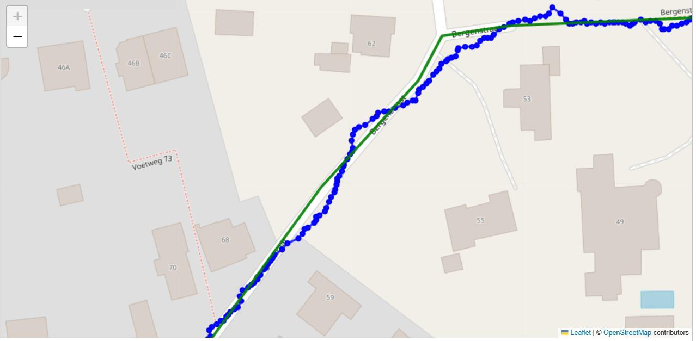

# PathSnap — Complete Hackathon Guidelines and Requirements

**PES University · Department of Computer Science and Engineering · RR Campus**  
**UE24CS352A: Machine Learning**

This README consolidates the **complete textual contents** of the five supplied PathSnap PDF documents into a navigable, Markdown-formatted reference. Their original order, requirements, tables, examples, questions, and warnings are preserved. Original section numbers have **not** been silently corrected; several source documents contain duplicated or skipped numbering. PDF page boundaries are marked in HTML comments for traceability.

The original guide's sample GPS/route map is included as a separate PNG. No actual dataset files, trained models, source code, completed experiments, measured results, API implementation, UI, or submitted technical report were included in these five PDFs; this README does not imply those deliverables have already been produced.

## Source documents

| Source PDF | Pages | Content |
| --- | ---: | --- |
| `Main Guidelines.pdf` | 2 | Problem overview, two-laptop architecture, overall process |
| `Dataset Exploration.pdf` | 4 | Raw data formats, exploration, coordinate considerations, partitioning |
| `Models and Training Guidelines.pdf` | 6 | Models, metrics, tuning, HMM/Viterbi, evaluation |
| `Deliverables.pdf` | 7 | Repository and technical report requirements, report questions and maps |
| `Assessment and Plagiarism Policy.pdf` | 3 | Assessment, experimentation and academic integrity |

**Total: 22 PDF pages.**

## Contents

1. [Main Hackathon Guidelines](#document-1-main-hackathon-guidelines)
2. [Dataset Description and Exploration](#document-2-dataset-description-and-exploration)
3. [Models and Training Guidelines](#document-3-models-and-training-guidelines)
4. [Technical Report and Submission Guidelines](#document-4-technical-report-and-submission-guidelines)
5. [Assessment and Academic Integrity Policy](#document-5-assessment-and-academic-integrity-policy)
6. [Source fidelity notes](#source-fidelity-notes)

---

## Document 1: Main Hackathon Guidelines

*Source: `Main Guidelines.pdf` (2 pages).*

<!-- Main Guidelines.pdf — PDF page 1 of 2 -->

### PES UNIVERSITY

#### Department of Computer Science and Engineering

**RR Campus**

**UE24CS352A: MACHINE LEARNING**

### PATHSNAP: DISTRIBUTED MAP-MATCHING & ROUTE RECONSTRUCTION

Hackathon Guide

### 1. Challenge Overview

GPS tracking systems often produce inaccurate location measurements due to urban buildings, signal interference, multipath effects, GPS dropouts and low sampling frequencies.

Consequently, a vehicle travelling along a road may appear to move onto a parallel street, jump across buildings or deviate from its actual route.

Your task is to develop PathSnap, a distributed machine learning system that reconstructs realistic vehicle trajectories by matching noisy GPS observations to a road network.

The challenge involves developing an end-to-end solution, from understanding and processing raw GPS data to training machine learning models, reconstructing routes and deploying the final system.

This is a folium map visualization of a trip from the provided dataset where the blue dots represent the raw gps points and the green line is the actual vehicle path (ground truth).

<!-- Main Guidelines.pdf — PDF page 2 of 2 -->

### 2. Important: Read Before Beginning

Students are strongly encouraged to thoroughly read all the supporting documents provided for this hackathon before beginning implementation or using AI tools.

These documents contain important information about the problem context, dataset, expected outcomes, technical requirements, evaluation criteria and submission guidelines. Understanding these details is essential for making informed technical decisions and successfully completing the challenge. Relying solely on AI-generated suggestions without first understanding the problem and the provided material may lead to incorrect implementation choices and incomplete solutions.

### 3. Two-Laptop Deployment Architecture

| Laptop | Component | Responsibilities |
| --- | --- | --- |
| Laptop 1 | Model and API | Hosts the trained classifier, HMM/Viterbi implementation, road-network information and server-side evaluation process |
| Laptop 2 | User Interface | Displays the ten evaluation-trip options, sends the selected trip to the API and displays the returned route and results |

### 4. Expected Work Process

The overall challenge should be approached in the following stages:

1. Understand the problem.
2. Explore and understand the raw dataset.
3. Develop an independent data-processing and feature-engineering approach.
4. Train and compare multiple machine learning models.
5. Select the best-performing model based on experimental evidence.
6. Perform Bayesian hyperparameter optimisation.
7. Implement HMM and Viterbi-based route reconstruction.
8. Export the trained model and required artifacts.
9. Develop the FastAPI backend.
10. Develop the evaluator-facing UI.
11. Integrate and test the complete system.
12. Prepare the final technical report.

---

## Document 2: Dataset Description and Exploration

*Source: `Dataset Exploration.pdf` (4 pages).*

<!-- Dataset Exploration.pdf — PDF page 1 of 4 -->

### PATHSNAP: DATASET DESCRIPTION AND EXPLORATION

Supporting Document

### 1. Purpose of This Document

This document introduces the raw dataset provided for PathSnap and outlines how teams should inspect and understand it before designing their solutions.

It describes the data at a conceptual level. Teams are responsible for investigating the actual files, validating their assumptions and determining how the information should be used.

### 2. Dataset Overview

The dataset contains GPS trajectory information and associated road-network information.

A trajectory records the observed movement of a vehicle over time, while the road network represents the geographical structure against which GPS observations must be matched.

The raw data package is organised by trip. Each trip contains files that describe its GPS observations and relevant road-network information.

Students must investigate the actual data and verify file naming, row counts, data types and column meanings rather than assuming every trip is identical.

### 3. Raw File Types

| Raw file | General meaning | What these files have |
| --- | --- | --- |
| .track | GPS observations associated with a trajectory | 3 whitespace-separated columns without headers: longitude, latitude, and timestamp in seconds. Nominally 1 Hz: about 97% of steps are exactly 1 s apart. |
| .nodes | Geographical nodes in the road network | 2 whitespace-separated columns without headers: longitude and latitude (0-based row index) |

<!-- Dataset Exploration.pdf — PDF page 2 of 4 -->

| Raw file | General meaning | What these files have |
| --- | --- | --- |
| .arcs | Connections between road-network nodes representing road segments | 2 integer columns without headers: from_node_id and to_node_id (0-based row index serves as arc_id) |
| .route | Reference route information, where supplied | 1 integer column without headers: chronological sequence of ground-truth arc_id values traversed by the vehicle. |

Important: Do not assume that a row in a GPS file corresponds directly to a row in a road-network file.

Understand the relationships between GPS observations, road-network nodes, road segments and reference routes before designing your processing pipeline.

### 4. Initial Dataset Exploration

Before implementing a solution, conduct a structured exploratory analysis.

Your initial analysis should identify:

- Number of trips in each partition.
- Number of GPS observations per trip.
- File availability and file sizes.
- Data types and column names.
- Missing or invalid GPS observations.
- Timestamp ordering and irregular time gaps.
- Geographical extent of each trajectory.
- Number of road-network nodes and road segments.
- Road-network connectivity.
- Isolated nodes and disconnected components.
- Trips with unusually large GPS gaps or other anomalies.
- Availability and structure of reference route information.

### 5. Geographical Data Considerations

When working with geographical coordinates, consider the following:

- Longitude and latitude are angular coordinates.
- Ordinary Euclidean distance in degrees is generally not an appropriate measure of physical distance.
- Choose and justify an appropriate projected coordinate system or geodesic distance calculation.
- Check coordinate order carefully.
- Inspect coordinate plausibility before relying on spatial calculations.
- Consider the effect of GPS noise, low sampling rates, gaps and irregular timestamps.

<!-- Dataset Exploration.pdf — PDF page 3 of 4 -->

Your geographical calculations should be appropriate for the scale and location of the dataset.

### 6. Reference Route and Data Limitations

Where reference route information is supplied, investigate how it is encoded and how it can be associated with the road network.

Treat supplied route information as reference information for the task. Do not assume that it represents independently verified, error-free physical ground truth.

GPS observations may not lie exactly on the road network.

Supplied reference routes may also have limitations.

Teams should identify these limitations, explain any assumptions made and avoid overstating the certainty of evaluation labels.

### 7. Dataset Partitions and Leakage Prevention

The complete dataset is divided into three partitions:

| Partition | Number of trips | Use |
| --- | --- | --- |
| Training | 80 | Training, development, cross-validation and model optimisation |
| Student testing | 10 | Development-stage evaluation and model comparison |
| Evaluator testing | 10 | Final evaluation only |

Important rules:

- No observations from the same trip may be distributed across different partitions.
- Evaluator-testing data must not be used for model training.
- Evaluator-testing labels must not be used for feature selection.
- Evaluator-testing results must not be used to choose algorithms or hyperparameters.
- Do not manually alter predictions based on known evaluation routes.
- Do not hardcode expected answers for evaluation trips.
- Fit learned preprocessing transformations using permitted training data only.
- Keep evaluator ground truth separate from the prediction pipeline.

### 8. Recommended Exploration Outputs

Teams should retain evidence of their dataset exploration.

<!-- Dataset Exploration.pdf — PDF page 4 of 4 -->

Suitable outputs include:

1. Dataset inventory showing trip counts, file counts and observation counts.
2. Summary statistics for trajectory length, sampling intervals and missing values.
3. Plots showing GPS coordinate distributions and trajectory patterns.
4. Interactive Folium maps showing selected GPS trajectories and the road network.
5. Tables or visualisations describing road-network size and connectivity.
6. A short record of data-quality issues, assumptions and decisions.

### 9. Expected Outcome

At the end of dataset exploration, each team should be able to explain:

- How the raw dataset is organised.
- What each raw file represents.
- How the different data components relate to one another.
- What the main data-quality concerns are.
- What assumptions influence the proposed map-matching approach.

Students are expected to develop their solutions based on their own understanding and investigation of the raw dataset.

---

## Document 3: Models and Training Guidelines

*Source: `Models and Training Guidelines.pdf` (6 pages).*

<!-- Models and Training Guidelines.pdf — PDF page 1 of 6 -->

### PATHSNAP: MODELS AND TRAINING GUIDELINES

Supporting Document

### 1. Purpose

This document defines the expectations for model experimentation, selection, optimisation and sequential route reconstruction in PathSnap.

Teams are expected to make independent technical decisions and justify them using experimental evidence.

### 2. Independent Model Selection and Experimentation

Students are strongly encouraged to explore different machine learning algorithms and experiment with models from multiple algorithm families.

The objective is not simply to obtain a high accuracy score, but to demonstrate an understanding of why a particular model is suitable for the given problem.

Teams must train and evaluate at least FIVE different models before selecting their final model. The selection must be supported by experimental results, performance comparisons and technical reasoning.

Directly selecting a model without conducting meaningful experiments will result in deductions during evaluation.

### 3. Exploring Different Algorithm Families

The following are examples and suggestions, not a fixed list.

| Algorithm family | Possible approaches | What to consider |
| --- | --- | --- |
| Linear and probabilistic | Logistic Regression, Ridge Classifier, SGD Classifier, Gaussian Naive Bayes | Decision boundaries, assumptions and probability estimates |

<!-- Models and Training Guidelines.pdf — PDF page 2 of 6 -->

| Algorithm family | Possible approaches | What to consider |
| --- | --- | --- |
| Instance-based | KNN, Distance-Weighted KNN, Radius Neighbours | Similarity, distance metrics and scaling |
| Tree-based | Decision Tree, Extra Trees | Nonlinear decision rules and overfitting |
| Ensemble | Random Forest, Extra Trees Classifier, Bagging | Stability and generalisation |
| Boosting | Gradient Boosting, HistGradientBoosting, XGBoost, LightGBM, CatBoost, AdaBoost | Sequential error correction and computational efficiency |
| Kernel-based | Linear SVM, RBF SVM, Polynomial SVM | Kernel suitability and feature scaling |
| Neural networks | Shallow MLP, Deep MLP, different hidden-layer configurations | Nonlinear representations, regularisation and training stability |
| Unsupervised and clustering | K-Means, Mini-Batch K-Means, Agglomerative Clustering, DBSCAN | Cluster interpretation and conversion into meaningful predictions |

These are suggestions, not a fixed list.

If an approach does not naturally produce supervised candidate probabilities, explain how it is adapted.

Clustering identifiers must not be treated as ground-truth labels without an appropriate mapping or evaluation procedure.

### 4. Experimental Design

Your model experimentation process must:

1. Train at least five distinct models.
2. Record the configuration of each model.
3. Use the 80 training trips for model fitting and cross-validation.
4. Use the ten student-testing trips for development-stage model comparisons.
5. Apply preprocessing consistently.
6. Avoid selecting models using training accuracy alone.
7. Record training time and inference time where practical.
8. Retain experiment logs, random seeds, configurations and results.

### 5. Evaluation Metrics

Choose metrics that reflect both candidate classification quality and the route-matching objective.

Report the following where applicable:

<!-- Models and Training Guidelines.pdf — PDF page 3 of 6 -->

- Accuracy
- Precision
- Recall
- F1-score
- Confusion Matrix
- Log Loss
- Observation-level Top-1 Accuracy
- Candidate Miss Rate
- Route Continuity
- Sequence-level Performance
- Training Time
- Inference Time

Observation-level Top-1 Accuracy: For each GPS observation, select the candidate with the highest predicted score and compare it with the corresponding reference road segment.

Candidate Miss Rate: Report the cases where the reference road segment is absent from the generated candidate set.

Teams must explain the primary metric used to select the final model and why it is appropriate.

### 6. Model Comparison and Selection

Compare at least five trained models.

Your comparison should identify:

- Model name.
- Algorithm family.
- Important configuration choices.
- Training or cross-validation performance.
- Student-testing performance.
- Precision.
- Recall.
- F1-score.
- Log loss, where applicable.
- Computational efficiency.
- Route Continuity

The final model selection must be supported by measured results and technical reasoning.

Consider:

- Generalisation performance.
- Stability across validation folds.

<!-- Models and Training Guidelines.pdf — PDF page 4 of 6 -->

- Probability quality.
- Inference speed.
- Model complexity.
- Compatibility with the sequential decoder.

Do not select a model solely because it achieves high training accuracy.

### 7. Bayesian Hyperparameter Optimisation

After the initial comparison, select a promising model and perform hyperparameter optimisation using a Bayesian search strategy.

Your optimisation process should:

1. Define a justified hyperparameter search space.
2. Specify the optimisation objective.
3. Use group-aware cross-validation on the 80 training trips.
4. Record the optimisation trials and their results.
5. Identify the best parameter configuration.
6. Refit the selected model using the chosen configuration.
7. Evaluate the tuned model on the ten student-testing trips.
8. Compare tuned and untuned performance.
9. Report computational cost.

The evaluator-testing partition must not be used to choose the search space, objective, hyperparameters, model or thresholds.

### 8. HMM and Viterbi Route Reconstruction

Independent candidate predictions may produce an unrealistic route.

For example, two consecutive GPS observations may be assigned to road segments that are not connected in the road network.

An HMM uses sequential information and road-network connectivity to identify a more coherent route.

The route reconstruction stage should use the selected model's outputs consistently.

### 9. Required Route-Reconstruction Experiments

Your implementation must:

- Describe the hidden-state representation.
- Preserve the candidate-to-road-segment correspondence.

<!-- Models and Training Guidelines.pdf — PDF page 5 of 6 -->

- Explain emission and transition modelling choices.
- Explain the Viterbi recurrence or chosen decoding procedure.
- Handle missing candidates and invalid transitions.
- Handle GPS gaps appropriately.
- Return a predicted road segment for each relevant GPS observation.
- Compare classifier-only predictions with classifier-plus-HMM predictions.
- Report pointwise accuracy and sequence-level performance.
- Analyse route continuity.

Optimise decoder parameters using training and student-testing data only.

### 5. Components you’ll need

| Components | Expected content |
| --- | --- |
| Data-processing implementation | Raw-data inspection, preprocessing, candidate generation where appropriate and feature engineering |
| Model experimentation implementation | Code that trains and evaluates multiple models and records results |
| Bayesian optimisation implementation | Bayesian hyperparameter optimisation and final tuned model |
| HMM and Viterbi implementation | Complete route reconstruction implementation and comparison against classifier-only predictions |
| API implementation | FastAPI backend that processes evaluation requests |
| UI implementation | User interface that communicates with the API and displays evaluation results |
| Model and configuration artifacts | Final model, preprocessing components, HMM configuration and other required inference assets |
| Technical report | Methodology, experiments, results, graphs, tables, geographical visualisations, analysis and conclusions |
| GitHub repository | Complete project repository with source code, requirements and README |

### 6. Final Evaluation

During the final evaluation:

1. The API must be running on Laptop 1.
2. The UI must be running on Laptop 2.
3. The evaluator opens the UI.
4. The UI displays the ten reserved evaluation trips.
5. The evaluator selects any one of the ten trips.
6. The UI sends the selected trip ID to the API.

<!-- Models and Training Guidelines.pdf — PDF page 6 of 6 -->

7. The API processes the selected trip through the complete prediction pipeline.
8. The API calculates prediction accuracy using its internal reference data.
9. The UI displays the predicted route and evaluation results.

The system must work for all ten reserved trips, not just a single demonstration example.

Ground-truth labels must remain server-side and must never be exposed to the prediction model or UI.

Hardcoded outputs or bypassing the API are not permitted, students are required to show the evaluator the api logs on the laptop receiving the inference requests on the endpoint.

### 11. Independent Implementation Requirement

Every team is expected to independently develop, train, experiment with and select its own models.

- Sharing trained model files, model weights, hyperparameter configurations, implementation code or experimental results between teams is strictly prohibited.
- Submitted model architectures, configurations, parameters, source code and trained artifacts, submitted through github, will be compared across teams.
- Unusually similar implementations or model artifacts may be flagged for further investigation.
- Teams must be able to explain their model selection, implementation decisions, training process and experimental results during evaluation.
- Confirmed unauthorised sharing or copied work may result in severe consequences.

---

## Document 4: Technical Report and Submission Guidelines

*Source: `Deliverables.pdf` (7 pages).*

<!-- Deliverables.pdf — PDF page 1 of 7 -->

### PATHSNAP: TECHNICAL REPORT & SUBMISSION GUIDELINES

Supporting Document | Mandatory for All Teams

There will be first phase evaluation before lunch break

### 1. Final Submission Requirements

Each team must submit exactly the following two deliverables:

#### Deliverable 1: GitHub Repository (made public)

The team's complete project source code must be committed and pushed to GitHub.

The repository must contain:

| Required Component | What must be included |
| --- | --- |
| Data processing | Source code used to read, inspect, clean and preprocess the raw dataset |
| Feature engineering | Complete source code for the team's feature extraction and preparation |
| Model training | Training scripts/notebooks for every model experimented with |
| Model evaluation | Code used for model comparison, evaluation metrics, plots and confusion matrices |
| Hyperparameter optimisation | Bayesian optimisation code, search configurations and experiment results |
| HMM and Viterbi | Source code for route reconstruction and decoding |
| API | Complete backend source code, including API endpoints and model-loading logic |
| UI | Complete evaluator interface source code |
| Deployment | Configuration files, dependencies and instructions required to run the system |
| Visualisations | Folium map-generation code and other plotting scripts |
| Supporting results | Relevant CSV files, experiment logs, configuration files and result summaries |

Important requirements:

<!-- Deliverables.pdf — PDF page 2 of 7 -->

- All source code used for training, evaluation, UI and API development must be committed to GitHub.
- Do not submit only the final trained model. The code used to produce it must also be available.
- Include the saved model weights and required configuration files, subject to repository size constraints.
- The repository must contain a README with installation, execution and deployment instructions.
- The repository must be organised into clearly named folders.
- The final repository must be accessible to the evaluators.
- Do not commit passwords, API keys, private credentials or other secrets.

#### Deliverable 2: Technical Report (PDF)

- Submit one consolidated PDF report per team.
- The report must follow the structure provided in this document.
- Include actual experimental results, tables, graphs and geographical visualisations.
- All results reported in the PDF must be verifiable using the submitted GitHub repository.
- Do not submit separate reports for individual models.

### 2. Required Report Format (points 2-7 to be included in the report)

The PDF must follow the sections below.

### 2.2 Dataset Understanding and Exploratory Data Analysis

Answer the following:

1. How did you preprocess the data?
2. What patterns did you observe during data exploration? What features did you extract and why the team chose those features?

Include:

- Missing-value analysis.
- GPS trajectory plots.
- Road-network visualisations.
- At least one geographical map created using Folium.

Clearly mention which dataset partition was used for each analysis.

<!-- Deliverables.pdf — PDF page 3 of 7 -->

### 3. Model Experimentation and Comparison

Teams must train and compare multiple models before selecting their final model.

A minimum of five models must be trained and evaluated.

Every model actually experimented with must be documented in the report.

### 3.1 Overall Model Comparison

Include a consolidated comparison table.

| Model | Algorithm Family | Key Configuration | CV Macro F1-score | Top-1 Accuracy | Route continuity | Student-Test Macro F1-score | Log Loss | Inference Time |
| --- | --- | --- | --- | --- | --- | --- | --- | --- |
| Model 1 |  |  |  |  |  |  |  |  |
| Model 2 |  |  |  |  |  |  |  |  |
| Model 3 |  |  |  |  |  |  |  |  |
| Model 4 |  |  |  |  |  |  |  |  |
| Model 5 |  |  |  |  |  |  |  |  |

Use actual results. If a metric is not applicable to a particular model, state N/A and explain why in the cell.

### 3.2 Compulsory Questions for EVERY Model

Create a separate subsection for each model trained.

The following questions must be answered for each individual model.

#### A. Model Understanding

1. Why did you consider this algorithm suitable for the PathSnap problem?
2. What are the major strengths and limitations of this algorithm for this task?

<!-- Deliverables.pdf — PDF page 4 of 7 -->

#### B. Training and Configuration

5. What were the important hyperparameters and their initial values?
6. What loss function or optimisation objective was used?

#### C. Experimental Results

7. What was the model's performance on the student-testing dataset?

8. What were the observation-level Top-1 Accuracy, Macro F1-score and Log Loss (where applicable) of the model on the student-testing dataset?

9. Did you observe overfitting or underfitting? What evidence supports your conclusion?

Do not provide only textbook descriptions of the algorithms. Answers must connect the algorithm's behaviour to your actual experiments, observations and results.

### 3.3 Model Visualisations (COMPULSORY FOR EVERY MODEL)

Must include graphs/plots as part of EDA. Also include folium map plots of any selected trip to visualize how data looks on map and maps wherever necessary in the entire process.

Include appropriate visualisations to support the comparison.

At a minimum, include:

- Cross-validation Macro F1-score comparison across all models.
- Student-testing Top-1 Accuracy and Macro F1-score comparison.
- Log Loss comparison, wherever applicable.
- Confusion matrices as optional diagnostic visualisations.
- Training and validation loss plots only for models that produce epoch-wise training histories.
- Every graph must be generated using actual experimental results.
- Also include plots comparing the performance of different models to justify model selection.
- Do not create artificial training curves for algorithms that do not produce training histories.

Every graph must be generated using actual experimental results.

Also include plots comparing the performance of different models to justify your model selection

Do not create artificial training curves for algorithms that do not produce training histories.

<!-- Deliverables.pdf — PDF page 5 of 7 -->

### 4. Bayesian Hyperparameter Optimisation (for the chosen model)

Answer:

1. Which hyperparameters were included in the search?
2. What ranges or distributions were considered?
3. What objective function was optimised?
4. How many optimisation trials were performed?
5. What were the best hyperparameter values obtained?
6. Did the tuned model outperform the untuned model?

Compare the untuned and tuned models using:

- Cross-validation Macro F1-score.
- Student-testing Top-1 Accuracy.
- Student-testing Macro F1-score.
- Log Loss, where applicable.
- Inference Time.

Use the same evaluation metrics and data partitions for both models.

### 5. HMM and Viterbi Route Reconstruction

Explain how your team implemented route reconstruction.

Answer:

1. What are the hidden states in your implementation?
2. How are emission probabilities calculated?
3. How are transition probabilities calculated?
4. How are missing candidates or large GPS gaps handled?
5. What happens when consecutive GPS observations suggest disconnected road segments?
6. Did HMM decoding improve the final route? Support your answer with experimental results.

Include a comparison of:

- Classifier-only predictions.

<!-- Deliverables.pdf — PDF page 6 of 7 -->

- Classifier predictions followed by HMM/Viterbi decoding.

Discuss improvements and cases where HMM decoding did not help.

### 6. Geographical Visualisation Using Folium

Folium-based geographical visualisation is mandatory.

The report must include interactive geographical maps generated from the team's actual implementation.

At a minimum, visualise:

- Original GPS observations.
- Relevant road-network geometry.
- Reference route, where available.
- Predicted route.

Your maps must:

1. Use distinguishable colours and markers for different route layers.
2. Include clear labels or a legend.
3. Have an appropriate geographical extent and zoom level.
4. Make it easy to compare the observed GPS trajectory with the predicted route.
5. Include layer controls where appropriate.

Submission requirements:

- Include at least one representative geographical map in the PDF as a screenshot or exported view.
- Commit the interactive Folium HTML map or the code required to generate it to GitHub.
- Include the map-generation code in the repository.

Do not submit unrelated or manually fabricated maps.

### 7. API, UI and Deployment

For this section,

Include:

- Screenshots of the working UI.
- Screenshots of successful API responses, on the CMD of the receiving laptop.

<!-- Deliverables.pdf — PDF page 7 of 7 -->

The submitted source code must match the implementation demonstrated during evaluation.

### 8. Academic Integrity, Plagiarism and AI Content Checks

All reports and GitHub submissions will be subject to academic integrity checks.

The evaluation process may include:

- Plagiarism checks on report content.
- Checks for copied or substantially similar AI-generated report content.
- Comparison of code, model configurations, model weights and experimental results across teams.
- Verification of reported metrics against actual experiment outputs.
- Technical questioning to establish whether team members understand the submitted work.

#### Important Rules

1. The report must represent your team's actual work and understanding.
2. Copying explanations, analysis, results or report sections from other teams is not permitted.
3. AI tools must not replace actual experimentation, technical understanding or independent analysis.
4. Do not submit AI-generated answers as a substitute for analysing your own model results.
5. Disclose AI assistance as required by the event's policies.
6. Every team member must be able to explain the code, experiments, results and conclusions in the report.

Similarities between submissions may be investigated. Confirmed plagiarism, unauthorised collaboration, fabricated results or violations of the AI-use policy may result in serious academic consequences, including mark deductions or disqualification, in accordance with the event's assessment and plagiarism policies.

---

## Document 5: Assessment and Academic Integrity Policy

*Source: `Assessment and Plagiarism Policy.pdf` (3 pages).*

<!-- Assessment and Plagiarism Policy.pdf — PDF page 1 of 3 -->

### PATHSNAP: ASSESSMENT AND ACADEMIC INTEGRITY POLICY

Supporting Document

### 1. Purpose

This policy explains how PathSnap submissions will be assessed and how organisers may review the originality and authenticity of submitted work.

It applies to:

- Source code.
- Model implementations.
- Model artifacts.
- Configurations.
- Experimental results.
- Technical reports.
- Demonstrations.

Assessment considers correctness, completeness, technical understanding, experimental rigour, reproducibility and the team's ability to explain its work.

A high score on one metric does not automatically compensate for missing or invalid parts of the system.

### 3. Evidence of Meaningful Experimentation

Teams must:

- Train and compare at least five models before selecting a final model.
- Support model selection with recorded experimental results.
- Explain the strengths and limitations of the chosen approach.
- Demonstrate Bayesian hyperparameter optimisation.
- Retain the optimisation search record.
- Evaluate models and the decoder using permitted development data.

Selecting a model without meaningful experimentation may result in deductions.

<!-- Assessment and Plagiarism Policy.pdf — PDF page 2 of 3 -->

### 4. Independent Work and Model Similarity Checks

STRICT INDEPENDENT-WORK REQUIREMENT

Each team must independently implement, train, evaluate and select its own models.

Sharing model files, trained weights, parameter configurations, implementation code, derived datasets or experimental results between teams is prohibited.

Submitted architectures, source code, hyperparameter configurations, trained weights, model artifacts and reported results will be compared across teams, across sections.

Similarities may be flagged for further review.

### 5. AI Tool Use and Report Authenticity

Reports and submitted written material may be checked for copied or AI-generated content.

Teams remain responsible for the accuracy and originality of all submitted content.

The following are prohibited:

- Submitting AI-generated analysis as evidence of experiments that were not performed.
- Fabricating metrics, graphs or code execution results.
- Fabricating citations or implementation details.
- Copying another team's report or substantive content.
- Misrepresenting AI-generated work as independently conducted experimentation.
- Submitting technical explanations that the team cannot explain or defend.

Every team member must be prepared to explain the technical claims, tables, graphs and design choices in the report.

### 6. Viva and Demonstration

During evaluation, organisers may ask team members to explain:

- Dataset structure.
- Data preprocessing.
- Feature-engineering decisions.
- Model comparisons.
- Model selection.
- Bayesian hyperparameter optimisation.
- HMM implementation.
- Viterbi decoding.

<!-- Assessment and Plagiarism Policy.pdf — PDF page 3 of 3 -->

- API implementation.
- UI implementation.
- Experimental results.

Teams should be able to demonstrate that they understand and can reproduce their submitted work.

### 7. Data Leakage and Evaluation Integrity

The following rules are mandatory:

- Evaluator-testing data must remain untouched during development.
- Evaluator ground-truth labels must not enter the student-side prediction pipeline or UI.
- Hardcoded predictions are prohibited, the repositories will be examined for any hard coded process.

### 5. Similarity Review and Investigation

Organisers will compare:

- Source code.
- Repository history.
- Model architectures.
- Model weights.
- Hyperparameter configurations.
- Experimental results.
- Technical reports.
- Graphs and tables.

Similarity may trigger a review or a request for further explanation.

Because standard algorithms and common approaches can naturally produce similarities, no single similarity measure should automatically be treated as proof of plagiarism.

---

## Source fidelity notes

- All 22 pages are represented in their respective document sections. Formatting is adapted for Markdown; line wrapping and table-cell line breaks have been normalized without altering their meaning.
- **The original numbering is retained**, including the Assessment Policy's jump from `1. Purpose` to `3. Evidence of Meaningful Experimentation`, its later repeated `5. Similarity Review and Investigation`, and the Models and Training Guidelines' headings `5. Components you’ll need`, `6. Final Evaluation` after section 9. The submission report also skips numbered model-question items 3 and 4 (going from 2 to 5), and begins its dataset section at `2.2`.
- In the report comparison table, broken line-wrapped labels (e.g. “Algorith m”) are normalized to readable header spellings while retaining the same columns.
- The map illustration from the main PDF is preserved as `PathSnap_README_assets/example-folium-trip.png`. The repeated PES University logo is saved as `PathSnap_README_assets/pes-university-logo.png`.
- This is a faithful transcription/format conversion of the provided PDF guidance, not a verified implementation, a proposed solution, or completed project report. All source restrictions concerning AI assistance, evaluation leakage, originality, and actual experimentation still apply.
