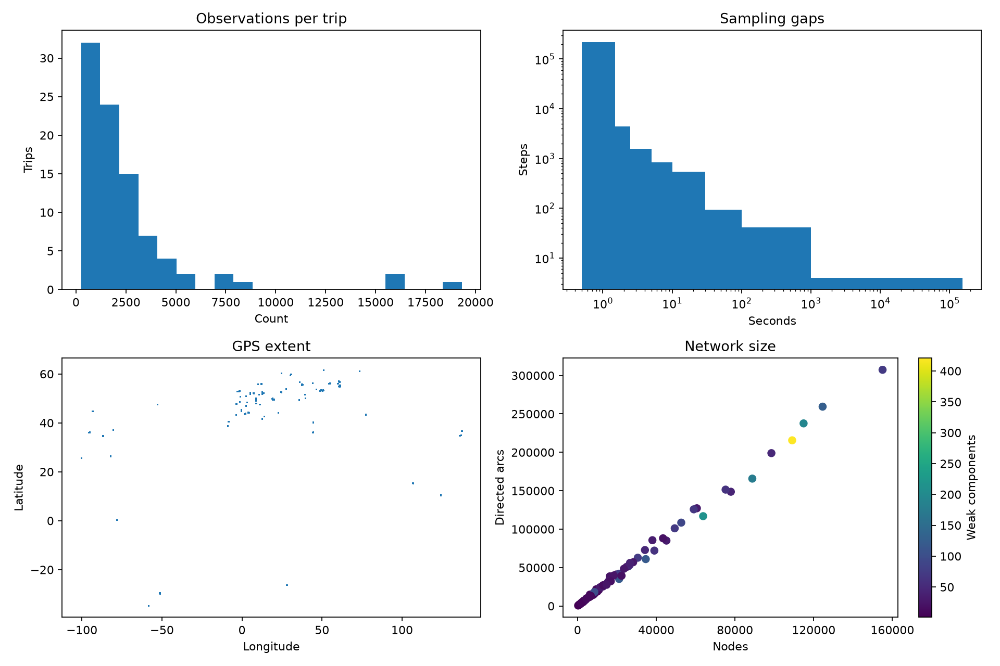
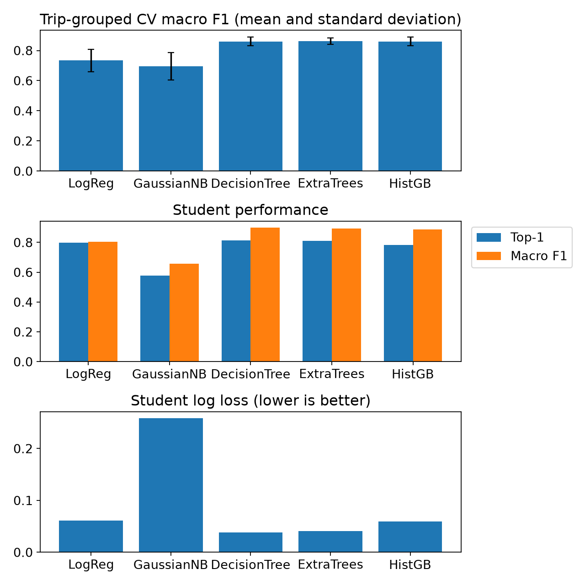
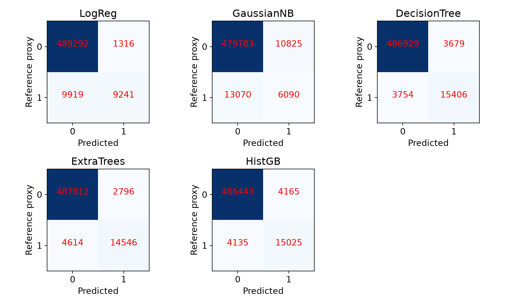
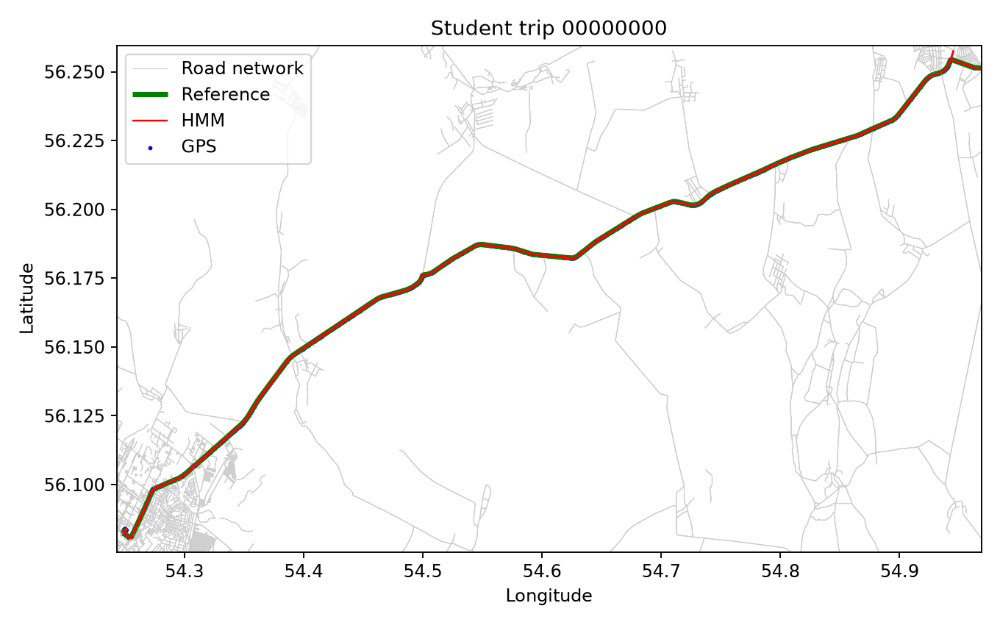

# PathSnap — Consolidated Project Report

This is the single submission report for deliverables A–D, measured results and
MLOps operations. README files provide quick-start instructions. Supporting
JSON/CSV files and plots contain the underlying evidence.

The frozen model is `HistGB-8623248d7844`. No retraining is required for the demo.
The results below use student-development data, not the reserved evaluator set.

## Contributor credits

These roles are supported by commits in the repository history, including the
remote main branch. Names are listed by deliverable, without ranking contributors
by commit count. Commit/push counts are not measurements of equal effort.

| Contributor recorded in Git | Documented contribution |
|---|---|
| S-Anuj-Srijan / anujs | Part A data audit, route labels, candidate features, EDA and project integration |
| ryonahh | Part B model zoo, trip-grouped CV, feature experiments, tuning and model export |
| Rufus15-06-2006 / RT | Part C dataset inspection, route alignment and HMM/Viterbi decoder on main |
| Haritej / RHaritej | Part D FastAPI, UI, two-laptop setup and later UI/model telemetry integration on main |

The current release also includes Codex-assisted implementation and documentation.
These credits preserve the recorded history; no equal contribution totals,
fabricated commits, backdated commits or reassigned authorship are claimed.
Newer main-branch enhancements remain on main; this release branch uses the
verified split frontend/backend implementation described below.

## Technical results: data, models and decoding

Distributed GPS map matching | Complete A-D implementation and measured student-development evaluation | 18 November 2026

This report is generated from repository artifacts. It reports actual experiments, not target scores. The available dataset contains 80 training trips and 10 student-testing trips; the reserved evaluator partition has not been used. Codex assisted implementation and documentation.

## 2.2 Dataset understanding and exploratory analysis

The raw formats are longitude/latitude/time tracks, longitude/latitude nodes, directed endpoint-index arcs, and chronological reference arc sequences. The pipeline validates dimensions, finite values, coordinate ranges, integer IDs and strictly increasing timestamps; it fails instead of silently cleaning malformed data. All 360 source files are inventoried with SHA-256, size, shape and dtype.

| Partition | Trips | Observations | Candidate miss rate |
| --- | --- | --- | --- |
| student_test | 10 | 19160 | 0.0000% |
| train | 80 | 208417 | 4.0117% |

EDA found 617 gaps above 10 seconds across 42 trips, with a largest gap of 153,064 seconds. There were no nonfinite/out-of-range coordinates or non-increasing timestamps. Networks span both hemispheres, so each uses its median-coordinate UTM zone. There are 90 distinct network hashes, 106 zero-length arcs, and 14 disconnected consecutive reference pairs across 11 routes. These are source-data findings from train and student partitions, not evaluator analysis.

Reference routes do not contain per-observation labels. A monotone dynamic program aligns each GPS point to route occurrences using squared spatial distance and a weak elapsed-progress tie breaker. Labels are proxies with ambiguous junctions, loops and displaced observations. High residual observations remain in the data. There is no ground-truth insertion into candidates.

Nine manual features describe distance, projected offset and offset fraction, heading difference, measured speed, arc length, distance rank, and endpoint degree. Distances and headings provide local geometric agreement; speed and graph degree describe motion and junction ambiguity. Undefined speed/heading use -1. The classifier input is an explicit allowlist; IDs, labels and route-derived audit fields are excluded. No automated feature-selection claim is made for this release.



## 3. Model experimentation and comparison

All five models were fitted on all 80 training trips and evaluated with 3-fold GroupKFold. Scaling is fitted inside each training fold. Model choice maximizes mean CV observation Top-1 accuracy, matching the road-selection objective. Student data is evaluated in full and does not choose hyperparameters. Seed is 42. Candidate F1, precision and recall are macro averages at a fixed 0.5 threshold; log loss measures binary candidate probability quality.

| Model | CV F1 | Student Top-1 | Student F1 | Log loss | Continuity |
| --- | --- | --- | --- | --- | --- |
| LogReg | 0.7334 | 0.7989 | 0.8053 | 0.0609 | 0.8927 |
| GaussianNB | 0.6955 | 0.5761 | 0.6567 | 0.2583 | 0.8655 |
| DecisionTree | 0.8598 | 0.8138 | 0.8990 | 0.0385 | 0.8986 |
| ExtraTrees | 0.8632 | 0.8096 | 0.8947 | 0.0413 | 0.8955 |
| HistGB | 0.8604 | 0.7834 | 0.8876 | 0.0592 | 0.8442 |

| Model | CV Top-1 | Fit seconds | Inference ms / 1k candidates |
| --- | --- | --- | --- |
| LogReg | 0.6708 | 10.35 | 0.189 |
| GaussianNB | 0.5110 | 1.30 | 0.560 |
| DecisionTree | 0.7005 | 161.89 | 0.187 |
| ExtraTrees | 0.7008 | 93.83 | 3.021 |
| HistGB | 0.7015 | 62.87 | 5.213 |

Timing values are local wall-clock measurements, not isolated hardware benchmarks. The HistGB comparison ran alongside another model to reduce total turnaround; resource contention can affect timing. Model selection uses CV quality rather than these timing differences.

Student candidate macro F1 is highest for DecisionTree, while student observation Top-1 is highest for DecisionTree. These metrics ask different questions: thresholded classification across mostly negative candidate rows versus choosing one road per observation. High candidate accuracy can be dominated by negatives. The chosen primary metric is grouped-CV Top-1; log loss and F1 remain supporting diagnostics.

### LogReg

Family: Linear. A scaled linear baseline tests whether geometric cues combine additively. Fast and interpretable, but cannot directly represent complex feature interactions. Objective: Logistic loss with L2 regularization; LBFGS optimization.

Initial configuration: Pipeline(steps=[('standardscaler', StandardScaler()),
                ('logisticregression',
                 LogisticRegression(max_iter=300, random_state=42))])

Important initial values: C=1, L2 penalty, LBFGS, max_iter=300; StandardScaler in each fold.

Student results: Top-1 0.7989, macro F1 0.8053, log loss 0.0609, macro precision 0.9277, macro recall 0.7398, candidate accuracy 0.9780. CV F1 0.7334 +/- 0.0744.

The student-minus-CV F1 gap is +0.0719. This compares different trip populations and label quality, so it cannot by itself establish overfitting or underfitting. Fold dispersion and student performance provide generalization evidence; no artificial training curves are produced.

### GaussianNB

Family: Probabilistic. A low-cost probability baseline. Correlated distance, offset and rank violate its independence assumption and can make confidence poorly calibrated. Objective: Gaussian class-conditional likelihood with conditional feature independence.

Initial configuration: GaussianNB()

Important initial values: var_smoothing=1e-9; class priors estimated from each training fold.

Student results: Top-1 0.5761, macro F1 0.6567, log loss 0.2583, macro precision 0.6668, macro recall 0.6479, candidate accuracy 0.9531. CV F1 0.6955 +/- 0.0923.

The student-minus-CV F1 gap is -0.0388. This compares different trip populations and label quality, so it cannot by itself establish overfitting or underfitting. Fold dispersion and student performance provide generalization evidence; no artificial training curves are produced.

### DecisionTree

Family: Tree. Captures feature thresholds and interactions. A single tree is unstable and produces coarse probability estimates; depth and leaf-size constraints limit variance. Objective: Greedy Gini impurity minimization.

Initial configuration: DecisionTreeClassifier(max_depth=12, min_samples_leaf=30, random_state=42)

Important initial values: max_depth=12, min_samples_leaf=30, Gini criterion.

Student results: Top-1 0.8138, macro F1 0.8990, log loss 0.0385, macro precision 0.8998, macro recall 0.8983, candidate accuracy 0.9854. CV F1 0.8598 +/- 0.0285.

The student-minus-CV F1 gap is +0.0392. This compares different trip populations and label quality, so it cannot by itself establish overfitting or underfitting. Fold dispersion and student performance provide generalization evidence; no artificial training curves are produced.

### ExtraTrees

Family: Ensemble. Averages nonlinear trees to reduce variance. More memory and latency than linear methods; random thresholds may miss precise geometric boundaries. Objective: Randomized split ensembles using Gini impurity.

Initial configuration: ExtraTreesClassifier(max_depth=16, min_samples_leaf=20, n_estimators=40,
                     n_jobs=4, random_state=42)

Important initial values: 40 trees, max_depth=16, min_samples_leaf=20, max_features=1.0, four workers.

Student results: Top-1 0.8096, macro F1 0.8947, log loss 0.0413, macro precision 0.9147, macro recall 0.8767, candidate accuracy 0.9855. CV F1 0.8632 +/- 0.0217.

The student-minus-CV F1 gap is +0.0315. This compares different trip populations and label quality, so it cannot by itself establish overfitting or underfitting. Fold dispersion and student performance provide generalization evidence; no artificial training curves are produced.

### HistGB

Family: Boosting. Learns nonlinear interactions with bounded trees and efficient histogram bins. Sensitive to complexity and probability calibration; random row-level early stopping is disabled to avoid within-trip validation. Objective: Binary log loss optimized by histogram gradient boosting.

Initial configuration: HistGradientBoostingClassifier(early_stopping=False, max_leaf_nodes=15,
                               random_state=42)

Important initial values: 100 iterations, learning_rate=0.1, max_leaf_nodes=15, min_samples_leaf=20, L2=0, early_stopping=False.

Student results: Top-1 0.7834, macro F1 0.8876, log loss 0.0592, macro precision 0.8873, macro recall 0.8878, candidate accuracy 0.9837. CV F1 0.8604 +/- 0.0287.

The student-minus-CV F1 gap is +0.0272. This compares different trip populations and label quality, so it cannot by itself establish overfitting or underfitting. Fold dispersion and student performance provide generalization evidence; no artificial training curves are produced.





## 4. Bayesian hyperparameter optimisation

The baseline CV leader exceeds the runner-up by only 0.076 percentage points. This is a small observed advantage, not a statistical claim of definitive superiority. The predeclared selection rule identifies one family for the finite tuning budget.

Chosen model: HistGB. The exact model-specific search space is encoded in mlops/train.py: LogReg C [0.01,10] log; GaussianNB smoothing [1e-12,1e-5] log; tree/ExtraTrees depth [8,22] and minimum leaf samples [5,100] log; HistGB learning rate [0.03,0.2] log, leaf nodes [8,40], L2 [1e-4,10] log, iterations [60,160]. Only the selected family is searched.

Optuna TPE completed 4 trials, including three startup trials. Objective: mean training-only group-CV Top-1. Further optimization was stopped to prioritize the working demonstration. One interrupted trial was marked failed and excluded from selection. Best parameters: {"learning_rate": 0.061053157936408836, "max_leaf_nodes": 39, "l2_regularization": 0.4570563099801455, "max_iter": 120}. Tuned model deployed: True.

| Metric | Untuned | Tuned |
| --- | --- | --- |
| cv_macro_f1_mean | 0.86039 | 0.86683 |
| cv_top1_mean | 0.70155 | 0.70614 |
| student_top1 | 0.78335 | 0.81273 |
| student_macro_f1 | 0.88756 | 0.89801 |
| student_log_loss | 0.05917 | 0.03611 |
| student_inference_ms_per_1k_cands | 5.21268 | 8.09932 |

Selection and promotion follow CV, not the student score. The tuned model is retained only when CV Top-1 is at least the untuned score. Final refitting uses all training trips. The limited completed search is not evidence of a global optimum; no further accuracy tuning is needed to run this demonstration.

## 5. HMM and Viterbi reconstruction

Hidden states are directed candidate arcs. Emissions are clipped positive-class classifier probabilities normalized across candidates per observation. Transition weights are exp(-abs(network distance - GPS displacement)/40 m), normalized over reachable next candidates. Network distance includes the remaining previous arc, bounded directed Dijkstra distance between endpoints, and next-arc offset. Same-arc movement permits 5 m backward jitter. The shortest-path bound is 2,000 m.

Viterbi uses score[t,j] = log emission[t,j] + max_i(score[t-1,i] + log transition[i,j]), then backtracks the maximizing predecessors. Missing candidates output -1 and break the chain. Gaps above 10 seconds or fully unreachable transitions restart the chain and are explicitly reported. These parameters are fixed engineering defaults; no decoder tuning is claimed.

| Metric | Classifier | Classifier + HMM |
| --- | --- | --- |
| top1 | 0.81273 | 0.84285 |
| continuity | 0.90136 | 0.96031 |
| route_jaccard | 0.67341 | 0.76810 |
| exact_sequence | 0.00000 | 0.00000 |

HMM changes pointwise agreement by +0.03011. Improvement is not guaranteed: transition assumptions may disagree with proxy labels at parallel roads, sharp turns, long gaps or reference-route discontinuities. Per-trip evidence is in sequence_metrics.csv. Continuity is strict endpoint adjacency, not general graph reachability. Route Jaccard ignores order; exact sequence match uses the entire proxy arc sequence. Pointwise means are observation-weighted; continuity is pair-weighted; exact-sequence match is trip-weighted.

| Trip | Classifier Top-1 | HMM Top-1 | Breaks |
| --- | --- | --- | --- |
| 00000000 | 0.9241 | 0.9489 | 0 |
| 00000007 | 0.9018 | 0.8892 | 0 |
| 00000009 | 0.8170 | 0.8561 | 0 |
| 00000040 | 0.8661 | 0.9109 | 0 |
| 00000052 | 0.9313 | 0.9885 | 0 |
| 00000056 | 0.8605 | 0.9106 | 0 |
| 00000065 | 0.7956 | 0.8438 | 3 |
| 00000076 | 0.7840 | 0.8553 | 24 |
| 00000077 | 0.6249 | 0.6188 | 0 |
| 00000091 | 0.8204 | 0.8490 | 0 |

## 6. Geographical visualisation

artifacts/experiments/route_map.html is the interactive Folium comparison, with raw GPS, road network, reference and predicted segment layers plus layer controls. The static figure below is generated from the same actual coordinates and predictions. It is an exported geometry view; interactive basemap tiles need internet access.



## 7. API, UI, deployment and MLOps

Laptop 1 hosts the backend API, model and graph. Laptop 2 opens its independent frontend/index.html and connects to Laptop 1 via the configured LAN API URL. The portable ZIP includes local map assets; no model or reference data is bundled. The UI requests /trips and POST /predict/{trip_id}; only prediction geometry, input GPS and aggregate scores are returned. Prediction and reference scoring are separate. The API reports proxy-label point accuracy and explicitly named route Jaccard. No dummy fallback remains.

The release validates model SHA-256 and feature schema before startup, fails on invalid trips or incorrect trip count, and exports data/source fingerprints, dependency versions and seed. /health, /ready and /metrics support operations. Structured JSON prediction logs record request ID, model version, latency and score. Docker mounts data/references read-only; CI runs synthetic tests without raw data. README documents installation, reproduction, environment configuration and rollback.

Automated API verification passed for 10 real student trips, with one predicted arc per observation and no reference arrays in responses. Scope: ten student-development trips via FastAPI TestClient; no physical two-laptop or Docker execution. GitHub publication, reserved evaluator scores and a physical two-laptop LAN test are not established by these checks.

| Trip | HTTP | Points | API seconds |
| --- | --- | --- | --- |
| 00000000 | 200 | 2503 | 7.20 |
| 00000007 | 200 | 1354 | 3.87 |
| 00000009 | 200 | 1049 | 8.23 |
| 00000040 | 200 | 2995 | 12.50 |
| 00000052 | 200 | 262 | 4.11 |
| 00000056 | 200 | 3958 | 29.69 |
| 00000065 | 200 | 768 | 7.04 |
| 00000076 | 200 | 1486 | 24.36 |
| 00000077 | 200 | 3911 | 25.35 |
| 00000091 | 200 | 874 | 6.91 |

## Reproducibility and remaining demonstration checks

Commands: python data_pipeline.py; python -m mlops.train; python -m mlops.evaluate; python -m unittest discover -s tests -v; python -m mlops.verify_release; python -m mlops.report. The README includes the complete file tree and operational runbook. All reported values can be traced to compact JSON/CSV artifacts; the model manifest identifies source hashes and dataset hash. No epoch-wise curves are claimed for the five selected algorithms.

Known limits: proxy labels, incomplete candidate coverage in training, a small student partition, fixed decoder defaults, bounded road-distance searches, and simplified straight arc geometry. This release predicts the observed segments; it does not insert unobserved connecting arcs into output geometry. No independently verified physical ground truth is available. Run the physical LAN/container checks and evaluator setup on the actual assessment machines, and publish the repository before submission.

## Complete MLOps implementation and runbook

<!-- operations-start -->

**Documented:** 18 November 2026
**Release model:** `HistGB-8623248d7844`
**Purpose:** Explain the MLOps work completed in this project, the files involved, how to operate it, and the evidence supporting each claim.

The MLOps work connects the existing data/model work to a reproducible, testable application. It covers data and feature consistency, experiment records, model packaging, validation, serving, monitoring, deployment configuration and the separate frontend delivery. The current model is exported and usable; **no further training or accuracy tuning is required to present it**.

This is a local hackathon deployment. Docker and CI configurations have been written, but their existence is not proof that a container or hosted CI run succeeded. The status table below distinguishes implemented work from checks actually completed.

## 1. What was completed

| Area | Work completed | Main files | Verification/status |
|---|---|---|---|
| Data integration | Connected the canonical pipeline to training and inference; retained input validation, inventory and data-quality evidence | `data_pipeline.py`, `A_PHASE1_README.md`, `artifacts/data/` | Four data tests passed on the available artifacts |
| Training/inference consistency | Explicit nine-feature schema; shared candidate/geometry implementation; inference casts features to float32 | `models/harness.py`, `backend/api/predictor.py` | Schema enforced when loading the model; real API predictions passed |
| Experiment management | Five-model comparison, trip-grouped cross-validation, seeded estimators, checkpoints, trial database and JSON/CSV records | `mlops/train.py`, `models/harness.py`, `artifacts/experiments/` | Five comparisons and four tuning trials completed |
| Model release | Exported fitted model, candidate settings, decoder settings and matching checksum manifest | `artifacts/model/best_model.joblib`, `best_model.json` | Artifact loaded successfully; checksum rejection tested |
| Sequence inference | Integrated directed-network HMM/Viterbi with explicit handling of gaps, disconnected transitions and missing candidates | `decoder.py`, `backend/api/predictor.py` | Decoder edge-case tests and real-trip evaluation passed |
| API serving | Replaced the placeholder prediction path with actual feature extraction, classifier probabilities and decoding | `backend/api/main.py`, `data_loader.py`, `predictor.py` | All ten student trips returned HTTP 200 in release verification |
| Label isolation | Prediction reads track/nodes/arcs; reference scoring occurs separately on the server afterward | `backend/api/data_loader.py`, `scoring.py`, `main.py` | Malformed input-directory route isolation tested; reference keys absent from checked responses |
| Observability | Liveness, readiness, per-process counters, request IDs, model version and prediction logs | `backend/api/main.py` | Readiness and a separate-origin HTTP prediction verified locally |
| Independent frontend | Extracted portable HTML/CSS/JS UI; configurable backend connection; bundled Leaflet assets | `frontend/` | JavaScript/configuration checks and independent asset serving passed |
| Packaging | Created a frontend-only ZIP and SHA-256 manifest | `scripts/package_frontend.py`, `dist/` | All 16 packaged files extracted and served successfully |
| Deployment configuration | Added Docker build, Compose volumes/port/health configuration and Windows/backend launchers | `Dockerfile`, `compose.yaml`, `backend/run_server.py`, `start_backend.ps1` | Python launchers verified; Docker execution remains unverified |
| Automated quality checks | Added decoder, artifact, API and split-deployment checks; configured GitHub Actions | `tests/`, `.github/workflows/ci.yml` | Eleven system/deployment tests passed locally; hosted CI success is not established |
| Reporting and operations | Generated technical Markdown/PDF report, file structure, setup instructions, troubleshooting and manual rollback procedure | `README.md`, `reports/`, `output/pdf/`, this file | Report generated and its rendered PDF layout inspected |

The data pipeline and earlier model exploration are project components that were reused and integrated. The MLOps layer does not mean every pre-existing file was newly created.

## 2. Architecture and ownership

```text
OFFLINE DEVELOPMENT — backend laptop / repository

Raw training files
    -> validation + inventory + feature generation
    -> features.parquet
    -> grouped model comparison + recorded tuning
    -> fitted model bundle + JSON manifest
    -> sequence evaluation + API release checks + report

LIVE PRESENTATION

Laptop 2: portable frontend
    -> GET /trips
    -> POST /predict/{trip_id}
                  |
                  v
Laptop 1: FastAPI backend
    input track/nodes/arcs
    -> shared candidate features
    -> verified classifier
    -> directed-network Viterbi
    -> prediction geometry and per-observation arc IDs
    -> separate server-side reference scoring, when available
                  |
                  v
Laptop 2: display GPS, predicted roads and aggregate scores
```

Laptop 1 keeps the model, datasets, references, Python environment and backend. Laptop 2 receives only the frontend. Model fitting and inference do not run in the browser.

The API implementation moved from `api/` to `backend/api/`. The old inline page was separated into `frontend/index.html`, `styles.css` and `app.js`. Imports, Docker paths, release checks and CI paths were updated. The root `run_server.py` delegates to `backend/run_server.py` for compatibility.

Shared ML components (`data_pipeline.py`, `decoder.py`, `models/`, `mlops/`) and data/model artifacts remain at the repository root as backend resources. The full repository stays on Laptop 1; `backend/` alone is not a complete transferable backend bundle.

## 3. Data quality, lineage and feature consistency

The canonical pipeline validates the input formats, builds an inventory and records file fingerprints. It retains data-quality findings rather than silently hiding them. The saved dataset summary contains:

| Item | Recorded value |
|---|---:|
| Training trips | 80 |
| Student-development trips | 10 |
| Training observations | 208,417 |
| Student observations | 19,160 |
| Total candidate rows | 6,172,468 |
| Training reference-arc candidate miss rate | 4.0117% |
| Student reference-arc candidate miss rate | 0% |
| Observations with no candidates in the saved dataset | 0 |

Source: [data summary](artifacts/data/summary.json). Detailed methodology is in [Part A documentation](A_PHASE1_README.md) and [data-quality notes](data_quality_notes.md).

Candidate generation selects at most 32 closest directed road segments within 300 metres. Geometry is projected using the network's local UTM zone. The reference arc is not inserted into the candidate set to manufacture a correct prediction.

Training and API inference use these exact nine features, in the same order:

```text
distance_m
offset_m
offset_fraction
heading_difference_rad
speed_mps
arc_length_m
distance_rank
from_degree
to_degree
```

The allowlist excludes trip IDs, arc IDs, labels and route-derived audit fields from classifier inputs. Inference calls the same `candidate_features` implementation as preprocessing and converts these columns to float32 to match the training artifact's representation. The saved bundle's feature list must equal the canonical list before serving predictions.

Reference `.route` files describe chronological arcs, not independent labels for every GPS point. Monotone alignment creates proxy point labels for development scoring. Consequently, displayed accuracy means agreement with those proxy labels. This is a data limitation, not a deployment guarantee.

## 4. Reproducible training and experiment records

[mlops/train.py](mlops/train.py) is the canonical training/export entry point. Earlier scripts under `models/` are retained for exploration history; their configurations and export formats should not be confused with the release path.

The release workflow:

1. Reads the feature table and checks that its partitions are `train` and `student`.
2. Requires 80 training trips and ten student trips, with no shared trip ID between partitions.
3. Uses the fixed feature schema and seed 42 for estimators/search that support randomness.
4. Compares Logistic Regression, Gaussian Naive Bayes, Decision Tree, Extra Trees and Histogram Gradient Boosting.
5. Uses three-fold `GroupKFold`, grouped by `trip_id`. A trip cannot appear in both sides of one fold.
6. Fits scaling within the Logistic Regression pipeline for each training fold. HistGB random row-level early stopping is disabled.
7. Selects the family with the highest mean grouped-CV observation Top-1 score. Student scores are reported rather than used as the selection objective.
8. Saves completed model checkpoints, fold metrics and student probabilities.
9. Searches the selected family's parameters using Optuna TPE and records trials in local SQLite.
10. Refits the chosen model on all training trips and exports it with its serving configuration.

The model comparison records include candidate accuracy, macro F1/precision/recall, log loss and confusion matrices, plus observation Top-1, candidate misses and timing. Candidate classification and observation-level road selection are different tasks, so their scores are named separately.

### What actually ran

All five model comparisons completed. The selected family was **HistGB**. Four tuning trials completed: three startup trials and one adaptive trial. A fifth interrupted trial was marked failed and excluded from selection. Further optimization was stopped at the user's request to prioritize a working presentation. The best completed configuration was refitted and exported without running another search.

The stored release configuration is:

```text
learning_rate       = 0.061053157936408836
max_leaf_nodes      = 39
l2_regularization   = 0.4570563099801455
max_iter            = 120
```

The tuned model is promoted only when its mean CV Top-1 is at least the selected untuned model's score. In this release, the tuned model was retained. No hidden evaluator data was used for the recorded development evaluation.

### Records and resume behavior

| Record | Purpose |
|---|---|
| `artifacts/experiments/run.json` | Seed, folds, feature schema, data/source hashes, versions, trip IDs and selection policy |
| `model_comparison.json` and per-model JSON files | Completed model results and configurations |
| `*_folds.csv` | Individual cross-validation fold metrics |
| `*_student_probabilities.npy` | Local probability arrays used for additional sequence diagnostics |
| `study.db` | Local Optuna study/trial persistence |
| `trials.csv` | Exported trial history |
| `tuning.json` | Release comparison, selected parameters and recorded stop/interruption status |

Resume checks compare the feature-table hash, selected source hashes, folds, feature schema, scikit-learn version and NumPy version with the earlier run. A mismatch raises an error and requires a new output directory. This prevents silently mixing some incompatible checkpoints.

These are local files, not an MLflow service, remote experiment store or model registry. SQLite and large probability arrays are ignored by Git. The trainer's generic summary counts all recorded trials; the current release summary was adjusted to distinguish four completed trials from one interruption. Re-running training can overwrite this release summary and the fixed model output path.

Fixed seeds and pinned packages improve repeatability; they do not guarantee identical timings or bit-for-bit results across operating systems and hardware. A Git commit field records the base checkout, while source hashes cover the listed source files; neither alone captures every uncommitted change in the entire repository.

## 5. Model packaging and integrity checks

The release consists of a matching pair:

- [best_model.joblib](artifacts/model/best_model.joblib): fitted classifier, feature list, seed, candidate settings and decoder settings.
- [best_model.json](artifacts/model/best_model.json): artifact checksum, model/run ID, training data/source fingerprints, package versions, trip lists and selection policy.

The current run ID is **`HistGB-8623248d7844`**, derived from the model name and the beginning of its SHA-256 checksum. It is returned in readiness/prediction responses and included in prediction logs so a result can be tied to an artifact.

The bundle includes `k=32`, candidate radius `300`, and decoder settings `beta_m=40`, `gap_s=10`, `max_distance_m=2000`. This avoids separately guessing those settings at deployment.

`ModelPredictor` performs the following startup checks:

1. Reads the matching JSON manifest.
2. Hashes the joblib file and rejects a checksum mismatch.
3. Checks the manifest's scikit-learn version against the runtime version when present. The release manifest contains this version.
4. Loads the bundle and checks the feature schema.
5. Creates the decoder from the bundle's recorded settings.

The application has no dummy-model fallback. A missing, corrupted or incompatible release fails startup rather than returning fabricated predictions. The checksum detects changed bytes; it is not a digital signature. Joblib artifacts must come from a trusted source because deserialization executes Python object-loading logic.

The full environment is specified in `requirements-lock.txt`; the predictor does not independently enforce every package version at startup. Its explicit runtime package check is scikit-learn compatibility.

## 6. Serving and inference behavior

The FastAPI lifespan loads the model and all configured trip networks before readiness. It checks the input directory and requires the configured trip count, which defaults to ten.

[backend/api/data_loader.py](backend/api/data_loader.py) requires one `.track`, `.nodes` and `.arcs` file per trip directory. It validates input geometry/timestamps through the loader and canonical network construction. It does not load `.route` files as inference inputs.

A prediction request performs real feature extraction, calls `predict_proba`, and then runs directed-network Viterbi decoding. The decoder restarts across time gaps above ten seconds or unreachable transitions. Missing candidates produce arc ID `-1`; reported breaks explain these cases. It selects actual road segments rather than fabricating a line between disconnected segments.

The response includes one predicted arc ID per observation, selected road geometry, the input GPS track, model version, request ID, prediction time, matched-observation count, continuity and decoder breaks. If a reference exists in the separate truth directory, the server calculates proxy accuracy and route Jaccard after inference. Reference arrays are not returned to the client.

### API endpoints

| Method/path | Operational meaning |
|---|---|
| `GET /health` | Process liveness; returns `status: ok` |
| `GET /ready` | Reports loaded trips, predictor type and model version; returns 503 when not ready |
| `GET /trips` | Lists input trip metadata and a short GPS preview |
| `POST /predict/{trip_id}` | Runs the real model/decoder and optional server-side scoring |
| `GET /metrics` | Returns the process's request/error counters and accumulated successful prediction time |
| `GET /docs` | FastAPI's interactive API documentation |
| `GET /ui/` | Optional UI preview when `frontend/` is available beside the backend |

Unknown trips return 404; an unavailable predictor returns 503. Inference failures return a generic 500 response containing a request ID, while the server logs the diagnostic exception.

The API runs without the frontend folder. The optional `/ui/` mount is a convenience, not a requirement for backend deployment.

## 7. Logs and monitoring

### Model comparison printed at startup

`backend/model_comparison.py` now prints a readable comparison immediately after
backend readiness. It reads the existing `model_comparison.json`, `tuning.json`
and `sequence_summary.json` under `artifacts/experiments/`:

- All five baseline models: CV Top-1, student Top-1, student macro F1 and student
  Top-1 change relative to Logistic Regression.
- Untuned versus tuned selected model: before/after CV Top-1, student Top-1 and
  macro F1, with signed percentage-point changes.
- Classifier versus classifier + HMM: before/after proxy Top-1 and strict
  continuity. HMM is identified as a decoding stage rather than another classifier.

The comparison is explicitly labelled a **saved development snapshot**. It does
not fit models or evaluate new trips at startup. Negative differences remain
visible, and student scores do not replace the training-only CV selection rule.
The live serving model version is printed separately. Replacing the weights does
not automatically regenerate these saved results, so refresh evaluation evidence
before describing the table as the new model's performance.

Comparison files are optional at runtime: missing, malformed or invalid numeric
scores generate a warning without preventing a valid model from serving. Docker
now includes just these three compact experiment JSON files for the same logs;
large experiment arrays and the trial database remain excluded.

Restart the backend to see the table, or preview it without opening a server:

```powershell
python -m backend.model_comparison
```

### Request events and counters

The service writes structured event messages for startup readiness, successful predictions and failures. Successful prediction fields include:

```text
event, request_id, trip_id, model_version,
elapsed_ms, points, accuracy, breaks
```

The response and logs share the request ID. This supports looking up a failed or slow demonstration request without exposing internal exceptions in the browser response.

`/metrics` currently exposes:

```json
{
  "requests": 0,
  "errors": 0,
  "prediction_seconds": 0.0
}
```

Those zero values illustrate the schema, not a live reading. Counters cover known-trip prediction attempts after readiness/ID checks. Unknown-trip 404s are not counted as prediction attempts. `errors` counts caught prediction failures, and `prediction_seconds` accumulates successful processing time.

These values are in-memory and per process. They reset when the process restarts and are not a persistent database, Prometheus exporter or monitoring dashboard. There is no automated alerting, drift detection or retraining trigger. Use one worker for the presentation; multiple workers would hold separate counters and model/network copies. No concurrency/load-test or service-level latency guarantee is claimed.

## 8. Dependencies, configuration and launchers

The validated local runtime uses Python **3.13.9**, scikit-learn **1.7.2** and NumPy **2.5.5**. Exact package pins are in [requirements-lock.txt](requirements-lock.txt); broader project constraints are in [requirements.txt](requirements.txt). `backend/requirements.txt` references the root lock rather than maintaining a second independent list.

A clean backend environment can be installed once from the repository root:

```powershell
python -m venv .venv
.\.venv\Scripts\python.exe -m pip install -r requirements-lock.txt
.\.venv\Scripts\python.exe backend/run_server.py
```

The prepared Windows laptop can use:

```powershell
.\backend\start_backend.ps1
```

The launcher supports an explicit `PATHSNAP_PYTHON`, otherwise prefers `.venv`, then the prepared `.runtime`/Anaconda combination if present, then `python` on PATH. It sets the working directory to the repository root. `.runtime` is a local ignored environment, not a required component of the frontend or a generally transferable Python installation.

If PowerShell blocks the launcher script, the prepared machine can run the interpreter directly:

```powershell
$env:PYTHONPATH='.runtime'
& "$env:USERPROFILE\anaconda3\python.exe" backend/run_server.py
```

The backend binds to `0.0.0.0:8000` by default, prints candidate LAN addresses, and defaults `OMP_NUM_THREADS` to four if not already set. Resource paths are resolved relative to the repository root, so starting inside `backend/` does not accidentally look for a model in the wrong directory.

| Environment variable | Default / effect |
|---|---|
| `PATHSNAP_DATA_DIR` | `Student folder/Student folder/student_test` |
| `PATHSNAP_TRUTH_DIR` | `ground_truth` |
| `PATHSNAP_MODEL` | `artifacts/model/best_model.joblib`; matching `.json` required |
| `PATHSNAP_EXPECTED_TRIPS` | `10`; startup must load this number |
| `PATHSNAP_CORS_ORIGINS` | `*`; comma-separated origins can restrict browser access |
| `PATHSNAP_PYTHON` | Optional interpreter override for the Windows launcher |
| `OMP_NUM_THREADS` | Launcher default `4`; controls supported OpenMP work |

The data/model/truth overrides accept absolute paths; relative paths resolve from the repository root. Training, evaluation and report commands should still be run from the repository root.

## 9. Portable frontend and two-laptop deployment

The frontend has no ML dependencies or model/data files. It contains local HTML, CSS, JavaScript, Leaflet 1.9.4 assets and the library's license. Core map geometry therefore works without an internet connection. The optional online basemap still needs internet and is off by default.

The connection flow supports:

- A **Backend URL** field and **Connect** button.
- HTTP/HTTPS origin validation; paths, credentials and query strings are rejected.
- Remembering a successful URL in browser storage when storage is available.
- Optional configuration through `frontend/config.js`.
- Automatic same-origin connection when served under backend `/ui/`.
- Connection/prediction timeouts and visible error messages.
- Resetting stale results when changing backends and ignoring responses from an earlier connection.

The backend's default CORS policy permits the portable file origin (`null`) and a separate local HTTP frontend. Browser credentials are not used. If HTTP origins are restricted with `PATHSNAP_CORS_ORIGINS`, list the frontend's actual origins and restart the backend. CORS is a browser access rule, not authentication.

### Packaging work

```powershell
python scripts/package_frontend.py
```

This writes `dist/PathSnap-frontend.zip` and `dist/frontend-manifest.json`. It checks required assets, excludes Python bytecode/cache files, verifies ZIP integrity and records SHA-256 hashes. The generated archive contains only paths under `frontend/`.

The verified package contains **16 files** and is **66,184 bytes**. A convenience copy was also placed at the repository root as `PathSnap-frontend.zip` so it is easy to find. The packaging script updates `dist/`; after a future rebuild, refresh the root copy if distributing that copy:

```powershell
Copy-Item .\dist\PathSnap-frontend.zip .\PathSnap-frontend.zip -Force
```

### Presentation procedure

1. On Laptop 1, start the backend and confirm `http://localhost:8000/ready` reports readiness.
2. Find Laptop 1's current Wi-Fi IPv4 address with `ipconfig`. If Laptop 1 is hosting the hotspot, use its hotspot adapter address instead. The launcher may also list virtual/VPN adapters, so select the interface actually shared with Laptop 2.
3. Connect both laptops to the same Wi-Fi or hotspot.
4. On Laptop 2, extract the entire frontend ZIP and open `frontend/index.html`.
5. Enter `http://<LAPTOP_1_ACTUAL_IP>:8000`, click **Connect**, then click a trip.
6. Keep the server terminal visible to demonstrate the matching request log.

Replace the placeholder with the current address; do not use an example IP from documentation. `localhost` on Laptop 2 refers to Laptop 2. `0.0.0.0` is a server bind address, not the client destination. IP addresses can change after switching networks.

If a browser blocks local-file requests, `frontend/start_frontend.bat` starts the optional Python 3 static server at `http://localhost:8080`. Enter Laptop 1's API URL in that page as before. This optional frontend HTTP server binds to Laptop 2's loopback interface.

## 10. Docker configuration

[Dockerfile](Dockerfile) defines a backend image based on `python:3.13-slim`, installs the lock file, copies the inference code and exported model, exposes port 8000 and checks `/ready`. It does not copy the frontend into the image.

[compose.yaml](compose.yaml) publishes port 8000, mounts the student inputs and truth directory read-only, sets the expected trip count and demo CORS setting, and uses `restart: unless-stopped`.

[.dockerignore](.dockerignore) excludes raw datasets, local environments, experiment outputs, reports, logs and other unnecessary build inputs. The weights/manifest needed for serving remain available to the build.

```powershell
docker compose up --build
```

**Status:** configuration implemented; a successful Docker build/run was not established in this workspace. The Python runtime was tested directly. A Linux container using this dependency lock still needs validation on a machine with Docker. The current base-image tag is not pinned by digest, and the Dockerfile does not add a dedicated non-root user. The readiness health check marks health; Compose's restart policy is not itself an automatic restart mechanism for a merely unhealthy but still-running process.

## 11. Tests, release verification and CI

### Local test suites

| Suite | Passed checks | Coverage |
|---|---:|---|
| `test_data_pipeline.py` | 4 | Geometry/direction, missing-candidate observation handling, route alignment, available data artifacts |
| `tests/test_system.py` | 6 | Global Viterbi path, gaps/missing candidates, disconnected transitions, empty candidates, checksum rejection, API/truth isolation |
| `tests/test_deployment.py` | 5 | Working-directory-independent resource paths, absolute overrides, CORS, frontend asset preview, API import/health without frontend |

The system/deployment run therefore reports **11 tests**, in addition to the four data tests. Evidence is in the local `reports/data_tests.log` and `reports/split_tests.log`; logs are ignored by Git.

The isolation test puts a deliberately malformed `.route` file alongside prediction inputs and confirms inference does not read it. The small test classifier is a synthetic fixture; it is not a runtime fallback or evidence of real model accuracy.

### Real release checks

[mlops/verify_release.py](mlops/verify_release.py) loads the actual exported model through FastAPI `TestClient` and checks all ten student trips. It verifies readiness, count, HTTP success, one predicted arc per input observation, valid arc ID bounds, absence of specified reference-label fields, unknown-trip 404 behavior and the optional UI route. It refuses to run against a data directory other than the development student partition.

The resulting [release_validation.json](reports/release_validation.json) records all ten successful results, runtime details and hashes of selected release files. The recorded local end-to-end times range from approximately **3.87 to 29.69 seconds per trip**. These are development-machine observations, not a performance guarantee.

Additional checks completed:

- Both frontend JavaScript files passed syntax checking.
- Configuration smoke checks covered standalone/file mode, unavailable browser storage, saved URLs, `/ui/` origin selection and invalid URLs.
- The actual ZIP was extracted independently and every packaged asset was fetched over a local HTTP server: [package evidence](reports/frontend_package_validation.json).
- A real cross-origin HTTP prediction succeeded for trip `00000007`, returning 1,354 predictions and `Access-Control-Allow-Origin: *`: [HTTP evidence](reports/split_http_validation.json).
- Launchers accepted invocation from the repository root and backend directory; the separate backend was also started from its own directory for the HTTP check.
- During connection troubleshooting, the running API was reachable through Laptop 1's local network addresses. This was a request from Laptop 1, not proof of connectivity from Laptop 2.

Release hashes describe the files at verification time. Later changes include report layout and optional model-comparison startup logging, plus Docker packaging of those saved comparison files. The older hash record is not an exact snapshot of these newer files. The 11 system/deployment tests passed again after the logging change (`reports/comparison_log_tests.log`), and signed deltas plus missing/malformed comparison handling were checked separately. The earlier ten-trip results remain evidence for the unchanged model/inference calculations; they were not re-run solely to add presentation logs.

### GitHub Actions

[.github/workflows/ci.yml](.github/workflows/ci.yml) runs on pushes and pull requests. It configures Ubuntu/Python 3.13, installs `requirements-lock.txt`, runs the system/deployment suite, runs three synthetic geometry/alignment tests, and compiles backend/model/MLOps Python code.

CI avoids depending on private raw data, full training or the heavyweight artifact test. It does not automatically train, build/push a container, publish a model or deploy the application. The recorded passed tests are local runs; check GitHub Actions for the hosted status after pushing.

## 12. Operating commands

Run these from the repository root in the installed backend environment. The prepared `.runtime` setup requires its `PYTHONPATH` and explicit interpreter as described above.

### Normal demo: use the existing model

```powershell
python backend/run_server.py
```

### Validate an existing release

```powershell
python -m unittest test_data_pipeline -v
python -m unittest discover -s tests -v
python -m mlops.verify_release
node --check frontend/app.js
node --check frontend/config.js
```

The first command requires the generated data artifacts. Node is only needed for developer syntax checks, not for a frontend user opening the HTML file.

### Refresh evaluation, report and frontend package

```powershell
python -m mlops.evaluate
python -m mlops.report
python scripts/package_frontend.py
```

Evaluation uses the frozen model and student data; it does not tune the classifier. The report generator consumes saved results and also refreshes the README's measured-results section. Packaging does not rebuild the model.

### Rebuild the ML pipeline only when intentionally requested

```powershell
python data_pipeline.py --data-root "Student folder/Student folder"
python -m mlops.train --folds 3 --trials 8
python -m mlops.evaluate
python -m mlops.verify_release
python -m mlops.report
```

The training command shows the original eight-trial budget, not the number completed for this release. It may resume/add trials and overwrites the standard model export location. It is unnecessary for the current demonstration. Preserve the current model/manifest before a deliberate retrain. For changed data/code/configuration, use a fresh experiment `--output` directory to avoid stale checkpoints; note that model export still targets `artifacts/model/`.

## 13. Manual promotion and rollback

The repository provides files and checks for a manual release process. It does not contain an automated deployment controller or model registry.

Before replacing the current artifact, retain the existing **joblib file and matching JSON manifest together** under a versioned location. Run tests and real-trip verification on the intended candidate, then select the new pair through `PATHSNAP_MODEL` and restart the backend. Check `/ready` for the expected `model_version` and run a prediction after startup.

To roll back, point `PATHSNAP_MODEL` to the retained previous joblib file and restart. The predictor looks for the JSON file with the same stem, so copying only the weights is insufficient. The existing serving artifact is not hot-reloaded when a file changes; a restart is required. Verification is command-driven and is not automatically enforced as a promotion gate by GitHub Actions.

Example, after a previous pair has actually been saved at this location:

```powershell
$env:PATHSNAP_MODEL='artifacts/releases/previous/best_model.joblib'
python backend/run_server.py
```

`artifacts/releases/previous/` is an illustrative backup location, not a claim that a previous release archive already exists.

## 14. Troubleshooting runbook

| Symptom | Check and action |
|---|---|
| Frontend says Connection failed | Open `http://<ACTUAL_BACKEND_IP>:8000/ready` from Laptop 2. Check the actual adapter IP, shared network and running backend first. |
| `/ready` works locally but not on Laptop 2 | Check network isolation and Laptop 1's trusted-network firewall permission for Python/TCP 8000. Do not disable the entire firewall. A shared hotspot can avoid isolated guest Wi-Fi. |
| Laptop 2 can open `/ready`, but frontend cannot connect | Check the backend origin field, browser local-network permission and CORS. Try the optional local frontend HTTP server. |
| Frontend cannot draw a map | Extract the entire ZIP, including `vendor/`; opening HTML inside an archive can break relative asset paths. |
| Port 8000 already in use | Check the existing server before starting another. A changed backend port must also be changed in Laptop 2's Backend URL. |
| Backend fails loading the model | Check both artifact files, checksum, feature schema and scikit-learn version; use the lock file. Do not bypass integrity checks. |
| Backend reports wrong trip count | Check `PATHSNAP_DATA_DIR`, its trip subdirectories and `PATHSNAP_EXPECTED_TRIPS`. |
| Prediction returns 500 | Locate the response's request ID in the backend logs and inspect the actual exception there. |
| Prediction works but accuracy is absent | A separate reference route was not found; prediction can still work without scoring. |
| A long request appears stuck | Consult the server log; the frontend allows up to five minutes for prediction. Existing trip timing varies substantially. |
| Training refuses to resume | Compare the recorded fingerprint/configuration; choose a fresh experiment output directory for intentional changes. |

## 15. Measured model results and their limits

The following existing results identify the frozen model's behavior; they are not further tuning performed for this document.

| Measure on ten student trips | Classifier only | Classifier + HMM |
|---|---:|---:|
| Observation Top-1 proxy agreement | 81.27% | 84.28% |
| Strict route continuity | 90.14% | 96.03% |
| Observation-weighted per-trip route Jaccard | 0.6734 | 0.7681 |
| Exact complete proxy sequence match, fraction of trips | 0 | 0 |

Source: [sequence_summary.json](artifacts/experiments/sequence_summary.json). Strict continuity means staying on one arc or sharing the directed endpoint between successive observations; it is stricter than general multi-edge reachability. Jaccard compares sets and ignores order. The metrics use different aggregation rules: point accuracy is observation-weighted, continuity is adjacent-pair-weighted and exact sequence match is trip-weighted.

The current candidate-based observation metric assumes observations appear in the candidate table. The saved dataset has no zero-candidate observations. Before using that classifier metric on a dataset that does, extend the denominator to the full observation inventory. The sequence decoder already represents missing predictions explicitly.

## 16. Remaining scope and unverified items

- **Physical two-laptop/browser completion:** server-side reachability, CORS and package checks passed; success from the second physical laptop has not yet been confirmed in the recorded work.
- **Docker:** configuration exists, but no successful container execution is claimed.
- **Hosted CI/publication:** the workflow exists; local evidence does not establish a passing remote run. Publication is identified by the pushed Git commit.
- **Reserved evaluator:** no evaluator partition results are included; defaults use student-development trips.
- **Security/hosting:** this is a trusted-LAN demo without application authentication, TLS, rate limiting or a hardened public deployment.
- **Monitoring:** no persisted telemetry, alerts, drift detection or automated retraining.
- **Artifact lifecycle:** hashes and local files provide traceability; no signed artifacts, remote model registry, DVC-managed dataset versions, automatic rollback, canary rollout or blue/green deployment was implemented.
- **Automation:** no scheduled training orchestration or cloud/Kubernetes deployment was implemented.
- **Reliability:** no concurrency stress testing, availability target or disaster-recovery validation is claimed. Local source/config hashes are records, not a backup service.

These boundaries are part of the handover: the delivered system is a verified local inference application with practical MLOps controls, not a claim of a fully managed production platform.

## 17. File map and evidence index

```text
ml_hackathon/
  REPORT.md                         Single consolidated project report
  ml ops.md                         Pointer to the report
  README.md                         Main setup, structure and presentation guide
  data_pipeline.py                  Shared preprocessing and features
  decoder.py                        Directed HMM/Viterbi
  test_data_pipeline.py              Data/geometry checks
  models/harness.py                 Shared validation/metrics
  mlops/
    train.py                        Comparison, tuning, export and fingerprints
    compare_one.py                  Optional individual comparison worker
    evaluate.py                     Frozen-model sequence evaluation and maps
    verify_release.py               Ten-trip API release verification
    report.py                       Measured Markdown/PDF report generator
  backend/
    model_comparison.py             Saved scores and signed improvements in startup logs
    paths.py                        Stable resource-path resolution
    run_server.py                   Backend launcher and LAN addresses
    start_backend.ps1               Prepared Windows runtime launcher
    requirements.txt                Reference to root dependency lock
    README.md                       Backend setup/runbook
    api/
      main.py                       Lifecycle, endpoints, logs and scoring orchestration
      data_loader.py                Prediction input loading without reference routes
      predictor.py                  Model verification and real inference
      scoring.py                    Server-only reference loading/Jaccard
  frontend/
    index.html / styles.css / app.js Portable browser interface
    config.js                       Optional default backend URL
    vendor/leaflet/                  Local map assets and license
    serve.py / start_frontend.bat    Optional local HTTP server
    README.md                       Frontend setup/runbook
  scripts/package_frontend.py        Portable ZIP and checksum manifest
  dist/                             Canonical frontend ZIP and manifest
  PathSnap-frontend.zip              Convenience copy for transfer
  artifacts/data/                   Data inventory, tables and EDA
  artifacts/experiments/            Model/fold/trial/sequence evidence
  artifacts/model/                  Release weights and matching manifest
  reports/                          Verification JSON, report source and local logs
  output/pdf/                       Rendered technical report
  tests/test_system.py              Six inference/artifact/API tests
  tests/test_deployment.py          Five deployment tests
  requirements*.txt                 Dependency specifications and exact lock
  Dockerfile / compose.yaml          Backend container configuration
  .github/workflows/ci.yml           Source quality gates
  .gitignore / .dockerignore         Exclusions for local/generated resources
  run_server.py                     Compatibility backend launcher
```

Useful documents and evidence:

- [Main README](README.md)
- [Backend instructions](backend/README.md)
- [Frontend instructions](frontend/README.md)
- [Model manifest](artifacts/model/best_model.json)
- [Experiment comparison](artifacts/experiments/model_comparison.json)
- [Recorded tuning outcome](artifacts/experiments/tuning.json)
- [Real API release verification](reports/release_validation.json)
- [Independent ZIP validation](reports/frontend_package_validation.json)
- [Separate-origin HTTP prediction](reports/split_http_validation.json)
- [Consolidated report](REPORT.md)
- Optional generated PDF: `output/pdf/PathSnap_Technical_Report.pdf` (local output, ignored by Git)

## 18. How to explain the MLOps work in the presentation

“We connected our training pipeline to a real inference service using the same features. We record experiments, save the model with its configuration and checksum, and validate the artifact before the API becomes ready. Automated tests cover decoding, corrupted artifacts, label isolation and separate frontend deployment, and all ten student trips passed API checks. We added request logs, model-version tracking, readiness and counters. The frontend is packaged independently for Laptop 2, while the model and references stay on Laptop 1. Docker and CI definitions are included; the deployment we have directly validated is the local Python service.”

## Repository packaging and handover

Source code, dependency locks, CI/container configuration, the compact release model/manifest, comparison JSON/CSV files, plots and verification JSON are retained in Git. Raw datasets, local environments, secrets, logs, caches, generated parquet tables, transfer ZIPs and duplicate generated reports are ignored. Existing large parquet/map files are removed from the current Git index only; local copies are retained. Their older committed history is not rewritten.

On a fresh clone, obtain the supplied raw student data separately. Run `python data_pipeline.py --data-root "Student folder/Student folder"` to recreate ignored feature tables for training; serving the exported model needs the input trip files but does not need those parquet tables. Run `python scripts/package_frontend.py` to rebuild the transferable ZIP. The compact selected model is intentionally retained so no training is required for the demonstration.
